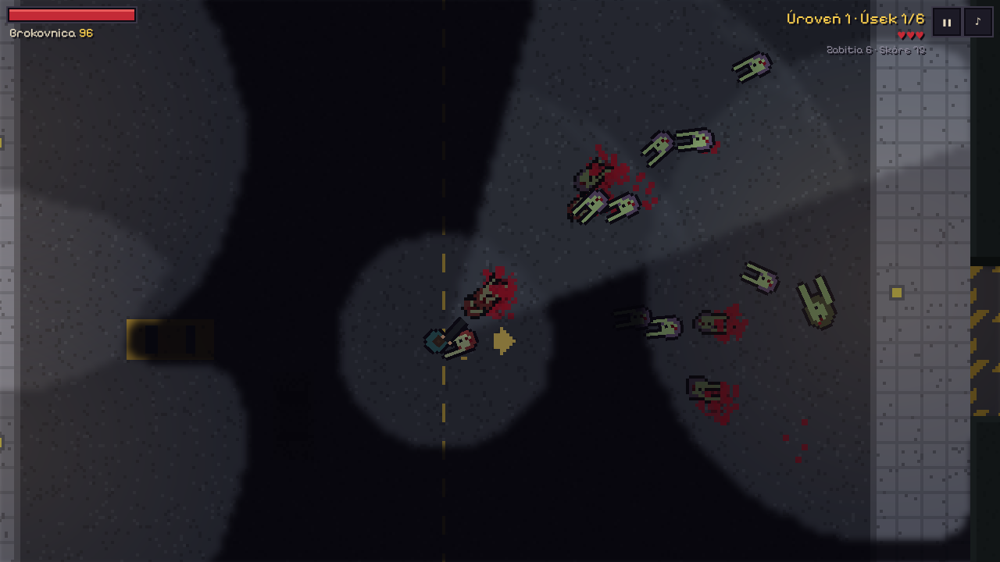
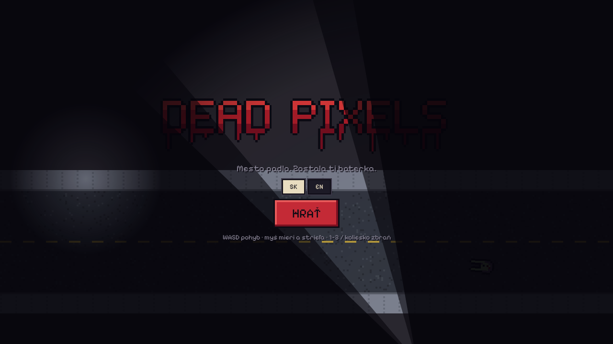
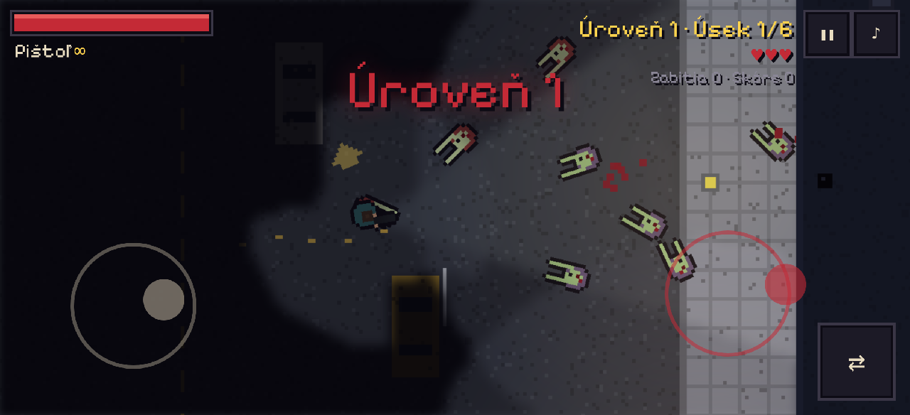

# Dead Pixels

Pixel art zombie strieľačka zhora pre prehliadač, inšpirovaná hrou Dead Nation. Mesto padlo,
je noc a zostala ti baterka. Kužeľ svetla vrhá tiene od budov a áut, z tmy prichádzajú vlny
zombie. Hrá sa na počítači aj na mobile.

TypeScript · Vite · PixiJS 8 · Vitest

**Hrať online:** https://darangonaut.github.io/dead-pixels/



| Úvodná obrazovka                                | Mobil (dve dotykové páčky)                    |
| ----------------------------------------------- | --------------------------------------------- |
|  |  |

## Spustenie

```sh
npm install
npm run dev     # http://localhost:5173
```

Nasadenie na GitHub Pages: `npm run deploy:pages` (vetva `gh-pages`).

## Ovládanie

| Akcia    | Počítač                 | Mobil (na šírku)           |
| -------- | ----------------------- | -------------------------- |
| Pohyb    | WASD / šípky            | ľavý palec (páčka)         |
| Mierenie | myš                     | pravý palec (páčka)        |
| Streľba  | ľavé tlačidlo / medzera | pravá páčka vychýlená viac |
| Zbraň    | 1–3, koliesko, Q / E    | tlačidlo ⇄                 |
| Zvuk     | M                       | tlačidlo ♪                 |

## Hra

- Úroveň je cesta cez 6–12 úsekov (ulica, ulička, parkovisko, park, sklad, námestie)
  pospájaných bránami — od havarovaného auta k evakuačnému heliportu. Každá ďalšia úroveň je
  dlhšia a ťažšia, zbrane, náboje a skóre sa prenášajú.
- V úsekoch: **horda** (brána za tebou sa zavrie, ďalej sa dá až po vyčistení), túlavé zombie,
  ktoré si ťa všimnú, keď ťa uvidia alebo začujú streľbu, a pokojné úseky so zásobami.
- Kontrolné body: po smrti začneš na začiatku úseku. 3 životy, +1 za každú dokončenú úroveň.
  Šípka pri hráčovi ukazuje smer k ďalším dverám.
- Zbrane: pištoľ (neobmedzené náboje), brokovnica, samopal. Náboje, lekárničky a nové zbrane
  vypadávajú zo zombie.
- Štvrte: úrovne 1–3 centrum mesta, 4–6 nemocnica (oddelenia, hala, chodby, sanitky),
  7–9 metro (nástupištia, tunely, vestibul), 10 vojenská základňa. Na 10. úrovni čaká na
  heliporte vrtuľník — útek z mesta je koniec príbehu, potom sa dá pokračovať v nekonečnom režime.
- Zombie: chodci, rýchli bežci, obri, nafúknuté (vybuchnú pri hráčovi aj po zastrelení — zrania
  aj ostatné zombie), pľujúce (držia si odstup a pľujú kyselinu) a boss Mäsiar na 5. a 10. úrovni
  (rozbehne sa za hráčom; keď narazí do steny, je omráčený).
- Tma: baterka, lampy (niektoré blikajú alebo nesvietia) a záblesky výstrelov.
- Krv a mŕtvoly zostávajú na zemi.

## Vývoj

`npm run typecheck && npm run lint && npm test` — logika hry (`src/game/`) je čistý TypeScript
bez grafiky a dá sa testovať vo Vitest. `?debug` sprístupní hru v konzole (`window.__dp`).

Štruktúra: `src/game/` (mapa, kolízie, viditeľnosť, cesty hordy, zbrane, vlny), `src/render/`
(PixiJS, pixel art kreslený v kóde, tma so svetlami), `src/input/` (myš, klávesnica, dotykové
páčky), `src/audio/` (zvuky z Web Audio), `src/ui/` (texty, logo).
